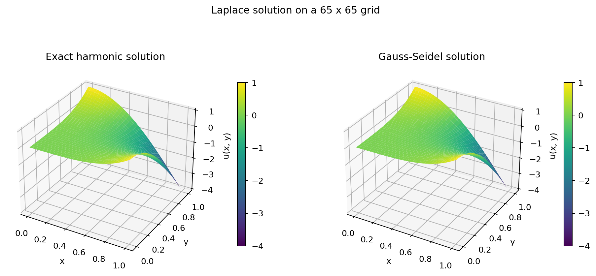
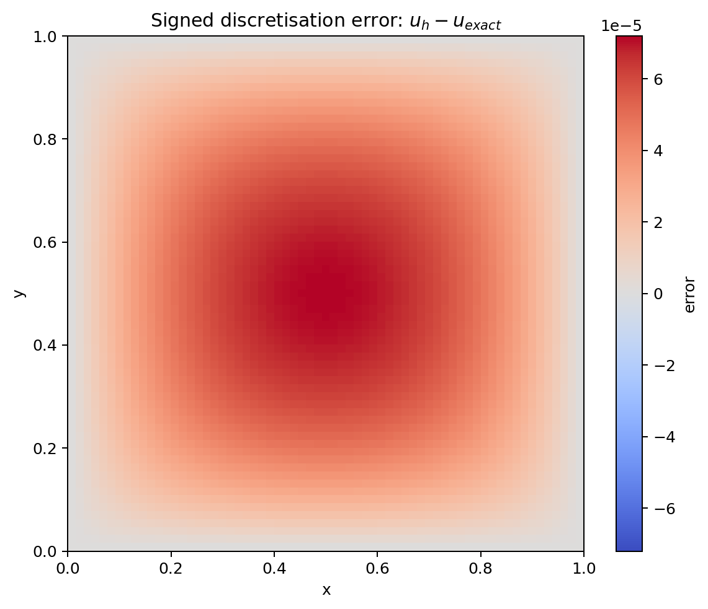
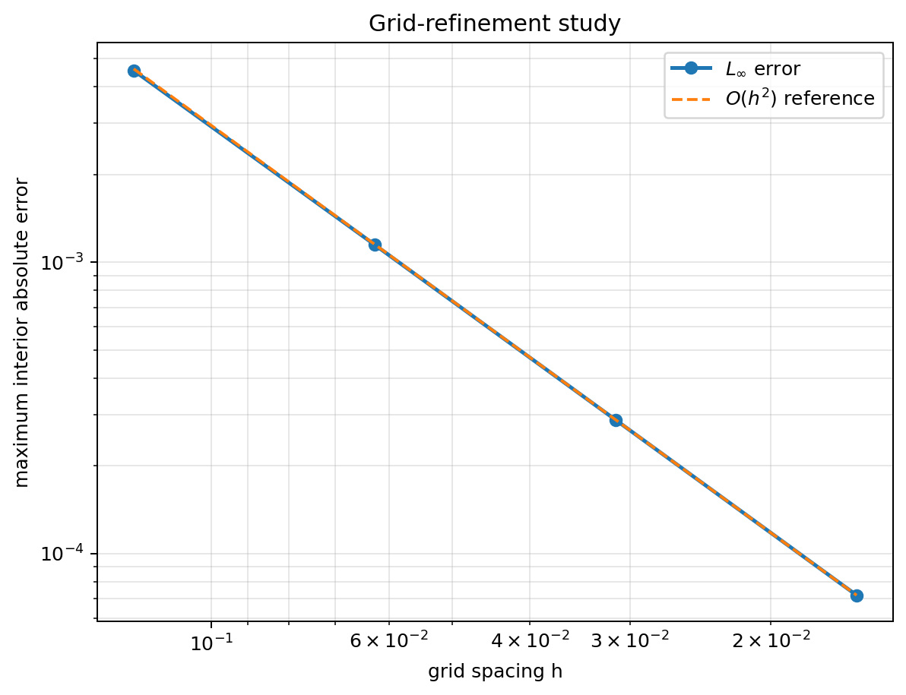

# 2D Laplace Equation Solver

A compact scientific Python project for solving the two-dimensional Laplace
equation on a square grid with the finite-difference method and Gauss-Seidel
iteration. The implementation is validated against an exact harmonic solution
and includes a grid-refinement study of the spatial error.

## Overview

The program solves a Dirichlet boundary-value problem on the unit square. A
complex function `f(z)` is supplied as a SymPy expression, and its real part

$$
u(x,y) = \mathrm{Re}(f(x+iy))
$$

is checked symbolically for harmonicity. Values of this exact solution define
the boundary conditions and provide an independent reference throughout the
domain. The numerical and exact solutions can therefore be compared directly.

The default validation case is

$$
f(z)=z^4, \qquad
u(x,y)=x^4-6x^2y^2+y^4.
$$

This function is harmonic, but it is not represented exactly by the five-point
stencil. It is therefore suitable for demonstrating the expected second-order
spatial convergence.

## Mathematical Model

For an electrostatic potential in a charge-free two-dimensional region,

$$
\nabla^2 u =
\frac{\partial^2 u}{\partial x^2}+
\frac{\partial^2 u}{\partial y^2}=0.
$$

On a uniform grid with spacing $h$, the second derivatives are approximated
with centred differences:

$$
\frac{
u_{i+1,j}+u_{i-1,j}+u_{i,j+1}+u_{i,j-1}-4u_{i,j}
}{h^2}=0.
$$

Rearranging gives the five-point update used by the solver:

$$
u_{i,j}=\frac{1}{4}
\left(u_{i+1,j}+u_{i-1,j}+u_{i,j+1}+u_{i,j-1}\right).
$$

## Numerical Method

The computational domain is $[0,1]\times[0,1]$, with the same number of grid
points in both coordinate directions. Exact values are assigned on all four
boundaries as Dirichlet conditions, while interior values are initially zero.

The solver performs in-place Gauss-Seidel sweeps over the interior points. It
stops when the largest absolute change during a complete sweep satisfies

$$
\max_{i,j}\left|u_{i,j}^{(k+1)}-u_{i,j}^{(k)}\right|\leq\varepsilon,
$$

or when the configured iteration limit is reached. The reported `converged`
flag must be checked before interpreting the error or convergence study.

## Validation and Convergence

For each grid, the code reports:

- the maximum absolute error over interior grid points,
  $\|u_h-u\|_\infty$;
- the root-mean-square error over interior grid points;
- the number of Gauss-Seidel sweeps; and
- the final maximum pointwise update.

For two grids with spacings $h_1>h_2$ and errors $E_1,E_2>0$, the observed
order is estimated using the actual spacing ratio:

$$
p=\frac{\log(E_1/E_2)}{\log(h_1/h_2)}.
$$

The default sizes `9, 17, 33, 65` halve the spacing at each refinement. With
the default quartic harmonic solution, the measured order approaches two, as
expected for the centred five-point discretisation. Functions that the stencil
reproduces exactly, such as linear harmonic functions, are useful correctness
checks but are not meaningful cases for estimating a spatial convergence
order.

## Visualisations

The default run creates four figures:

- exact and numerical solution surfaces;
- a signed pointwise error map;
- exact and numerical horizontal cross-sections; and
- a log-log grid-convergence plot with an $O(h^2)$ reference line.







## Project Structure

```text
.
|-- run.py                 # command-line entry point
|-- src/
|   |-- cli.py             # argument parsing and application orchestration
|   |-- symbolic.py        # SymPy parsing and harmonicity checks
|   |-- solver.py          # five-point Gauss-Seidel solver
|   |-- analysis.py        # grid study and convergence-order calculation
|   |-- plotting.py        # scientific visualisations
|   `-- models.py          # typed numerical result container
|-- tests/                 # pytest scientific validation suite
|-- images/                # figures produced by the documented example
|-- requirements.txt       # runtime dependencies
`-- requirements-dev.txt   # runtime and test dependencies
```

## Installation

Python 3.10 or newer is recommended.

```bash
git clone https://github.com/ShOOmet14/laplace_equation_electric_potential.git
cd laplace_equation_electric_potential
python -m venv .venv
```

Activate the environment on Linux or macOS:

```bash
source .venv/bin/activate
```

On Windows PowerShell:

```powershell
.venv\Scripts\Activate.ps1
```

Install the runtime dependencies:

```bash
python -m pip install -r requirements.txt
```

## Usage

Run the documented quartic validation case and save the figures in `images/`:

```bash
python run.py
```

Use another complex function whose real part is harmonic:

```bash
python run.py --function "exp(z)" --grid-size 65
```

Display the generated Matplotlib figures interactively as well as saving them:

```bash
python run.py --show
```

For a faster single-grid run without convergence analysis:

```bash
python run.py --skip-grid-study --grid-size 33
```

See every option with `python run.py --help`.

## Testing

Install the development dependencies and run the complete suite:

```bash
python -m pip install -r requirements-dev.txt
python -m pytest
```

The tests cover symbolic harmonicity, rejection of non-harmonic expressions,
constant-function broadcasting, exact boundary values, solver convergence,
accuracy, snapshots, invalid inputs, error metrics, grid refinement, and the
observed convergence order. GitHub Actions runs the same suite on every push
and pull request.

## Technologies

- Python
- NumPy
- SymPy
- Matplotlib
- pytest

## Limitations

- The domain is a uniform square grid on $[0,1]\times[0,1]$.
- Only Dirichlet boundary conditions sampled from a known exact solution are
  supported. This makes the project a validation-focused Laplace solver, not a
  general electrostatics simulator.
- The implementation uses basic Gauss-Seidel iteration. It is intentionally
  transparent, but it becomes slow on fine grids compared with SOR, multigrid,
  or sparse direct methods.
- The symbolic check proves harmonicity only to the extent that SymPy can
  simplify the Laplacian. Expressions with singularities or branch cuts may be
  unsuitable even if their Laplacian simplifies to zero; non-finite values on
  the sampled grid are rejected.
- The command-line expression parser is intended for locally supplied,
  trusted input.

## Future Development

Realistic extensions include accepting independently specified boundary data,
supporting rectangular domains with unequal grid spacing, comparing
Gauss-Seidel with successive over-relaxation, and adding a residual-based
diagnostic alongside the current maximum-update stopping criterion.
